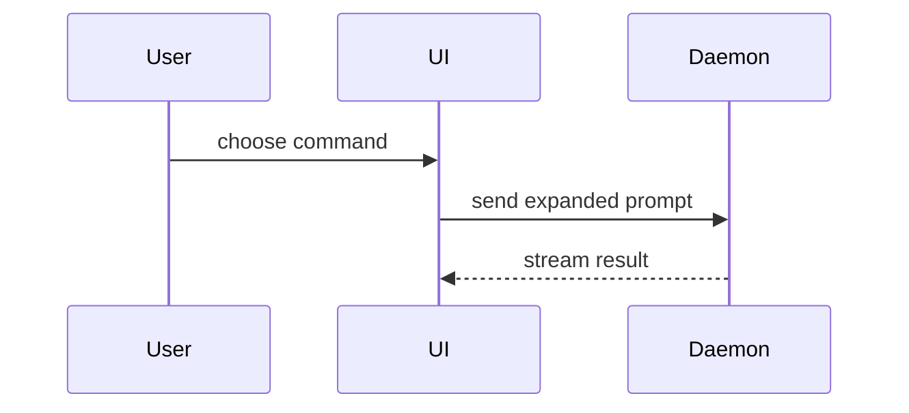

# Visual summary

Read this when a PR body needs a picture of the change: a flow, a structure or a before-and-after shape that prose would take longer to explain.

Credit: this menu of visuals and its placement guidance come from Dex Horthy's `show-me` skill (HumanLayer, MIT, see LICENSE-humanlayer). Matt Pocock's `pr` skill reproduced it almost word for word and aimed it at a diff instead of a live conversation (MIT, see LICENSE-mattpocock). This file adapts both.

## Contents

- [Pick the smallest view](#pick-the-smallest-view)
- [Show a change with diff](#show-a-change-with-diff)
- [Placement](#placement)

## Pick the smallest view

Pick the smallest view that makes the key point clear.

- Show logic or an algorithm as pseudocode:

```text
on(save)
  if content is unchanged
    return cached result
  write new content
  return fresh result
```

- Show runtime control flow as a call tree:

```text
submitForm
  createSession
    persistPrompt
    launchAgent
  navigateToSession
```

- Show UI structure as a component tree, including state and module boundaries that matter:

```text
<SessionPage> (apps/example/src/routes/session.tsx)
  useSessionEvents()
  <SessionToolbar>
    <RunSkillButton> (packages/ui)
```

- Show file responsibility or a broad refactor as a shallow file tree:

```text
src/
├── commands/       # parses user actions
├── sessions/       # owns session state
└── transport/      # sends API requests
```

- Show component interaction, control flow, or data flow with Mermaid:



- Show the whole block when most of it is new, when omitted context would hide ownership or order, or when the reviewer needs a copyable target shape:

```ts
function expandSkill(command: string): string {
  const skillName = command.slice(1);
  return `use the ${skillName} skill`;
}
```

- For a visual UI or layout change, a screenshot or short recording from the running app beats any diagram. Attach one when the host can upload it; do not start a server or open files just to make a picture.

## Show a change with diff

Use `diff` when the point is what changes and the surrounding shape already exists. Match the diff shape to the topic.

For a component change:

```diff
 <SessionPage>
   useSessionEvents()
   <SessionToolbar>
+    <RunSkillButton />
   <SessionTimeline>
+    <SkillResultCard />
```

For a file-layout change:

```diff
 src/
 ├── commands/
+│   └── show-me.ts       # expands the slash command
 ├── sessions/
-└── transport.ts
+└── transport/
+    ├── client.ts
+    └── stream.ts
```

For a call-tree or call-stack change:

```diff
 submitForm
   createSession
     persistPrompt
+    expandSkillMention
     launchAgent
-  navigateToSession
+  navigateToSession
+    subscribeToEvents
```

For a state or control-flow change:

```diff
 on(save)
-  write content
+  if content is unchanged
+    return cached result
+  write new content
+  invalidate cache
```

## Placement

Place each visual next to the short text it supports. Keep only the calls, files, props, states, and boundaries the reviewer needs to understand this change.

You may use one of these, you may use several; it is unlikely you will use all of them. Use your judgement and don't overwhelm the reviewer.
